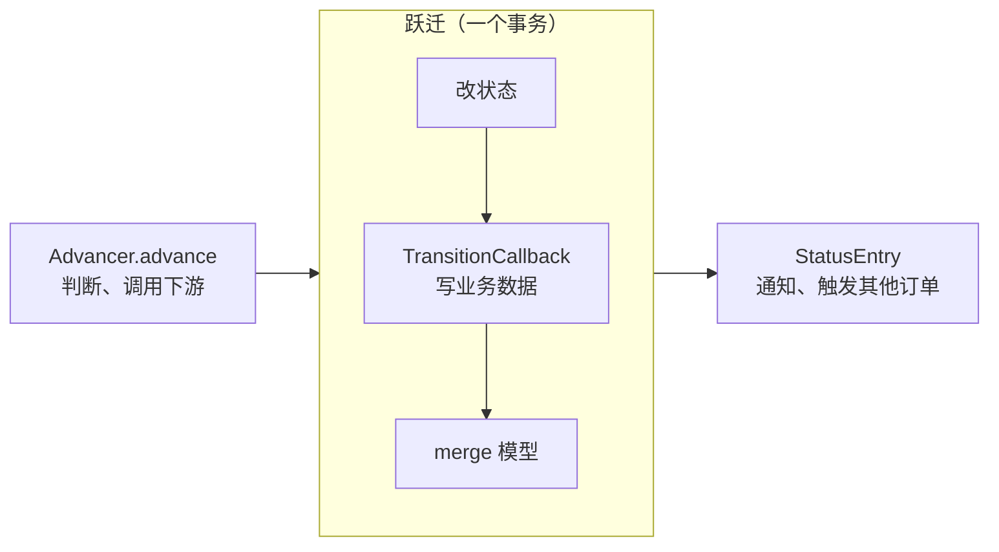
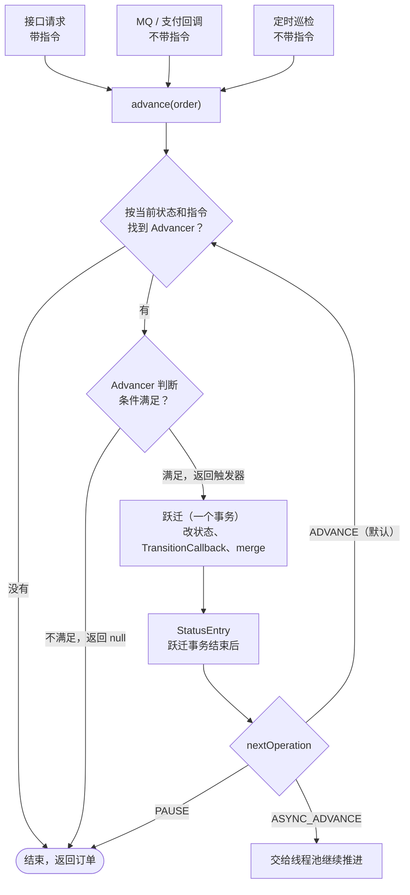
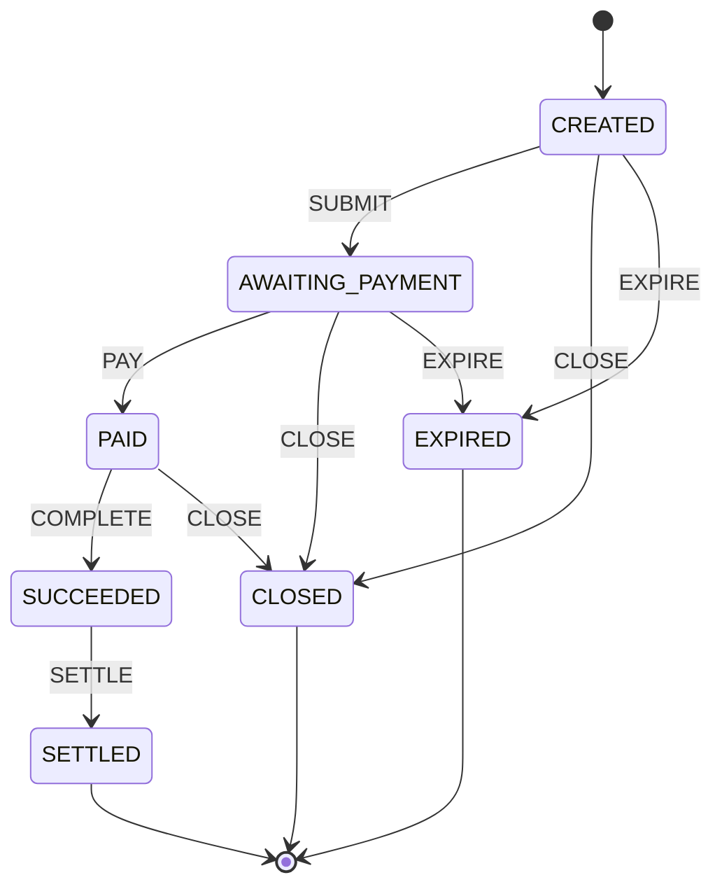
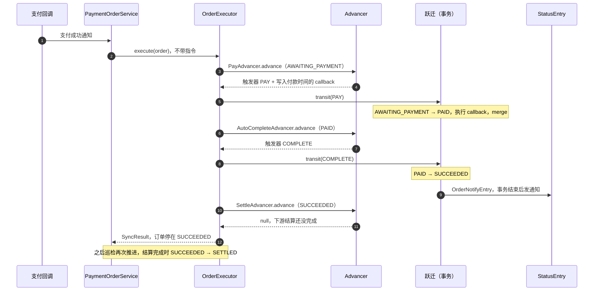

# godmonth-status2 使用教程

godmonth-status2 是一个基于注解的订单状态机框架。业务方只需要写三样东西：

- **状态机定义 JSON**：某个状态遇到某个触发器，跳到哪个状态；
- **Advancer**：订单停在某个状态时，判断现在该不该往前走、用哪个触发器；
- **StatusEntry**（可选）：订单进入某个状态之后要做的事。

路由、跃迁事务、回调顺序都由框架负责。本教程用一个通用的支付订单 `PaymentOrder` 贯穿始终，一步步完成接入。

---

## 1. 使用思路

开始写代码之前，先理解这个框架背后的三条约定。后面所有的写法都是从这三条推出来的。

### 1.1 推进是幂等的

订单不是"一次调用跑完全程"，而是**随时可以再推一次**。同一张订单的推进（`advance`）可能来自接口请求、MQ 回调、定时巡检，会重复、会并发，也会在中途失败后重来。所以：

- **Advancer 只根据事实做判断**：订单当前的状态和数据，加上外部事实（下游结果、是否超时等）。条件不满足就返回 `null`，框架什么也不做，订单保持原样，等下一次推进。
- **同样的事实，同样的结论**：推进一次和推进十次，订单都收敛到同一个状态。
- **对下游的调用要可重入**：Advancer 调用下游时，用订单号等业务唯一键作为幂等号，重复调用不会产生重复效果。
- **并发靠锁兜住**：模型加 `@Version` 乐观锁，两个线程同时跃迁同一张订单时，后提交的一方因版本冲突失败、事务回滚，下次推进再按最新状态判断。业务操作入口也可以先用悲观锁（`SELECT ... FOR UPDATE`）取订单。

### 1.2 跃迁是事务性的

Advancer 返回触发器之后，框架执行一次**跃迁**（`transit`）。跃迁在**同一个事务**里完成三件事：

1. 按 JSON 定义算出下一个状态，写到模型上；
2. 执行 `TransitionCallback`，写入这次跃迁附带的业务数据；
3. merge 模型。

三步一起提交，或者一起回滚，不会出现"状态变了、业务数据没写进去"的情况。跃迁的事务边界只包住这三步：Advancer 的判断在事务之前，StatusEntry 在事务之后。



于是每件事该放在哪里就很清楚了：

| 要做的事 | 放在哪 | 原因 |
|---|---|---|
| 查询下游结果、调用外部接口 | `Advancer.advance` | 在事务外，不长时间占用数据库事务；失败了下次推进重来 |
| 写与这次跃迁绑定的业务数据（金额、时间、关联单据） | `TransitionCallback` | 与状态在同一个事务里，一起提交或回滚 |
| 发通知、触发其他订单推进 | `StatusEntry` | 跃迁事务结束后执行，不影响跃迁本身 |
| 绕过框架直接改状态字段并保存 | 不要这样做 | 绕过了 JSON 定义和跃迁事务 |

### 1.3 定时巡检兜底

既然推进是幂等的，补偿就很简单：**定时扫描未到终态的订单，再推进一次**。

- 进程在异步推进途中重启、下游结果到了但回调丢了，订单会停在中间状态，巡检会把它接着推下去；
- 超时关闭这类依赖时间的跃迁，本身就是靠巡检触发的；
- StatusEntry 里做的通知、下游推进如果失败，也应该能被巡检补上。

### 1.4 一次推进的全过程



---

## 2. 核心概念

| 概念 | 说明 | 谁来写 |
|---|---|---|
| 状态（Status） | 模型上带 `@Status` 注解的枚举字段 | 业务方（枚举） |
| 触发器（Trigger） | 状态之间的边；JSON 定义"某状态遇到某触发器跳到哪个状态" | 业务方（枚举 + JSON） |
| 指令（Instruction） | 外部命令，例如"确认""关闭"，用来在同一个状态下选择不同的 Advancer；推进时可以不带指令 | 业务方（枚举） |
| Advancer | 绑定到某个状态，或（状态, 指令），判断该不该跃迁、用哪个触发器 | 业务方实现 `StatusAdvancer` |
| 跃迁 | 按 JSON 定义改状态，在事务内执行 TransitionCallback 并 merge | 框架 |
| TransitionCallback | 跃迁事务内执行的业务写入 | 业务方（可选） |
| StatusEntry | 进入某个状态、跃迁事务结束后执行的回调 | 业务方实现 `StatusEntry`（可选） |
| OrderExecutor | 推进入口，提供 `execute` / `executeAsync2` | 框架，由 `@OrderExecutor` 注解装配 |

> 指令和触发器是两回事：指令是"外部想让订单做什么"，用来挑选 Advancer；触发器是"状态机沿哪条边走"，由 Advancer 决定。两者名字可以相同（比如都叫 `CLOSE`），但不要混用。

---

## 3. 示例状态机



每个非终态都有 Advancer 负责推进：

| 绑定状态 | 绑定指令 | Advancer | 条件满足时的触发器 | 跃迁后 |
|---|---|---|---|---|
| CREATED | CONFIRM | `ConfirmAdvancer` | SUBMIT | PAUSE，停下等支付 |
| CREATED | — | `ExpireAdvancer` | EXPIRE（已超时） | 继续推进 |
| AWAITING_PAYMENT | — | `PayAdvancer` | PAY（已付款）/ EXPIRE（已超时） | 继续推进 |
| PAID | ACCEPT | `AcceptAdvancer` | COMPLETE | 继续推进 |
| PAID | — | `AutoCompleteAdvancer` | COMPLETE（满足自动确认条件） | 继续推进 |
| CREATED / AWAITING_PAYMENT / PAID | CLOSE | `CloseAdvancer` | CLOSE | 继续推进 |
| SUCCEEDED | — | `SettleAdvancer` | SETTLE（下游结算已完成） | 继续推进 |

---

## 4. 接入步骤

### 4.1 引入依赖

在 `dependencyManagement` 中导入 `status-bom`，由它统一各模块版本：

```xml
<dependencyManagement>
    <dependencies>
        <dependency>
            <groupId>com.godmonth.status2</groupId>
            <artifactId>status-bom</artifactId>
            <version>3.1</version>
            <type>pom</type>
            <scope>import</scope>
        </dependency>
    </dependencies>
</dependencyManagement>

<dependencies>
    <dependency>
        <groupId>com.godmonth.status2</groupId>
        <artifactId>builder</artifactId>
    </dependency>
</dependencies>
```

`builder` 会传递引入其它模块（annotations、analysis、advancer-core、transitor-core、transitor-tx、merger-jpa、executor-core）。如果代码里直接用到这些模块的类型，也可以把它们显式列出来。

3.x 版本基于 Java 17、Spring 6 / Spring Boot 3 和 Jakarta Persistence。框架默认从 Spring 容器中按类型取 `TransactionOperations` 和 `EntityManager`；用 Spring Boot + Spring Data JPA 时这两个 Bean 都已自动配置好。

### 4.2 定义枚举

```java
public enum PaymentOrderStatus {
    CREATED, AWAITING_PAYMENT, PAID, SUCCEEDED, SETTLED, CLOSED, EXPIRED
}

public enum PaymentOrderTrigger {
    SUBMIT, PAY, COMPLETE, SETTLE, CLOSE, EXPIRE
}

public enum PaymentOrderInstruction {
    CONFIRM, ACCEPT, CLOSE
}
```

### 4.3 领域模型标注 `@Status`

在状态字段上加 `@Status`，并声明触发器的枚举类型：

```java
@Entity
@Table(name = "payment_order")
@Getter
@Setter
public class PaymentOrder {

    @Id
    private Long id;

    @Enumerated(EnumType.STRING)
    @Status(triggerClass = PaymentOrderTrigger.class)
    private PaymentOrderStatus status;

    @Version
    private Long dataVersion;          // 乐观锁，见 1.1

    private Date paidTime;
    private Date settledTime;
    // 其它业务字段 ...
}
```

- 框架通过 Bean 属性读写状态，模型需要有状态字段的 getter / setter；
- `@Status` 也可以标在 getter 上。

### 4.4 编写状态机定义 JSON

放在 classpath 下，例如 `src/main/resources/json/status-machine-payment-order.json`：

```json
[
  {
    "status": "CREATED",
    "triggers": [
      {"trigger": "SUBMIT", "nextStatus": "AWAITING_PAYMENT"},
      {"trigger": "CLOSE", "nextStatus": "CLOSED"},
      {"trigger": "EXPIRE", "nextStatus": "EXPIRED"}
    ]
  },
  {
    "status": "AWAITING_PAYMENT",
    "triggers": [
      {"trigger": "PAY", "nextStatus": "PAID"},
      {"trigger": "CLOSE", "nextStatus": "CLOSED"},
      {"trigger": "EXPIRE", "nextStatus": "EXPIRED"}
    ]
  },
  {
    "status": "PAID",
    "triggers": [
      {"trigger": "COMPLETE", "nextStatus": "SUCCEEDED"},
      {"trigger": "CLOSE", "nextStatus": "CLOSED"}
    ]
  },
  {
    "status": "SUCCEEDED",
    "triggers": [
      {"trigger": "SETTLE", "nextStatus": "SETTLED"}
    ]
  }
]
```

- `status`、`trigger`、`nextStatus` 写枚举名，按 `@Status` 声明的类型反序列化；
- 终态没有出边，不用写；
- 跃迁时如果（当前状态, 触发器）在 JSON 里没有定义，会在进入事务之前直接抛异常，订单状态不变。

### 4.5 定义绑定注解

Advancer 和 StatusEntry 通过注解声明自己绑定到哪些状态、哪个指令。推荐每个状态机自定义一对以枚举为值的注解，类型安全，写错了编译不过：

```java
@Target(ElementType.TYPE)
@Retention(RetentionPolicy.RUNTIME)
@Documented
public @interface PaymentOrderStatusBinding {
    PaymentOrderStatus[] value();
}

@Target(ElementType.TYPE)
@Retention(RetentionPolicy.RUNTIME)
@Documented
public @interface PaymentOrderInstructionBinding {
    PaymentOrderInstruction value();
}
```

> 也可以不自定义，直接用框架自带的 `@StatusBinding(statusClass = ..., statusValue = {...})` 和 `@InstructionBinding(instructionClass = ..., instructionValue = ...)`，但它们的值是字符串，写错了只能在运行时发现。框架会优先读取下一步在配置类里登记的自定义注解，找不到时才回退到这两个自带注解。

### 4.6 声明执行器

每个状态机写一个配置类：用 `@OrderExecutor` 声明执行器，再提供一个 `StateMachineAnalysis` Bean，告诉框架模型类型和绑定注解。

```java
import com.godmonth.status2.builder.executor.OrderExecutor;   // 注意：这是注解

@Configuration
@OrderExecutor(beanName = "paymentOrderExecutor",
        stateMachineDefinitionResource = "classpath:/json/status-machine-payment-order.json",
        advancerBasePackages = "com.example.payment.statusmachine.payment.advancer",
        entryBasePackages = "com.example.payment.statusmachine.payment.entry",
        stateMachineAnalysisRef = "paymentOrderAnalysis",
        threadPoolRef = "threadPool")
public class PaymentOrderStatusMachineConfig {

    @Bean(name = "paymentOrderAnalysis")
    public StateMachineAnalysis<PaymentOrder> stateMachineAnalysis() {
        AnnotationBeanModelAnalysis<PaymentOrder> analysis =
                AnnotationBeanModelAnalysis.<PaymentOrder>annoBuilder().modelClass(PaymentOrder.class).build();
        return StateMachineAnalysis.<PaymentOrder>builder()
                .modelAnalysis(analysis)
                .statusBindingField(AnnotationField.builder().annoClass(PaymentOrderStatusBinding.class).build())
                .instBindingField(AnnotationField.builder().annoClass(PaymentOrderInstructionBinding.class).build())
                .build();
    }
}
```

`@OrderExecutor` 的属性：

| 属性 | 必填 | 说明 | 不填时 |
|---|---|---|---|
| `beanName` | 是 | 注册到容器的执行器 Bean 名 | — |
| `stateMachineDefinitionResource` | 是 | 状态机定义 JSON 的位置 | — |
| `advancerBasePackages` | 否 | 扫描 Advancer 的包 | 配置类所在的包 |
| `entryBasePackages` | 否 | 扫描 StatusEntry 的包 | 配置类所在的包 |
| `stateMachineAnalysisRef` | 否 | `StateMachineAnalysis` Bean 名 | 按类型取唯一 Bean；有多个状态机时必须填 |
| `transactionOperationsRef` | 否 | 跃迁使用的事务模板 Bean 名 | 按类型取 `TransactionOperations` |
| `entityManagerRef` | 否 | merge 使用的 `EntityManager` 或 `EntityManagerFactory` Bean 名 | 按类型取 `EntityManager` |
| `threadPoolRef` | 否 | 异步推进使用的线程池 Bean 名 | 每个执行器自建一个无界的 cached 线程池 |

生产环境建议显式配置一个有界线程池：

```java
@Bean(name = "threadPool")
public ExecutorService threadPool() {
    int cores = Runtime.getRuntime().availableProcessors();
    return new ThreadPoolExecutor(cores, cores * 4, 60L, TimeUnit.SECONDS,
            new LinkedBlockingQueue<>(2000),
            new ThreadPoolExecutor.CallerRunsPolicy());
}
```

### 4.7 编写 Advancer

#### 绑定规则

- Advancer 用状态绑定注解声明状态，可以绑定多个；需要按指令区分时，再加指令绑定注解；
- 推进时，框架先按（当前状态, 指令）找 Advancer，找不到再只按当前状态找；都找不到，本次推进结束；
- 同一个绑定键只能有一个 Advancer，重复会在启动时报错 `advancer keys are duplicated`；
- 类必须满足：是顶层类（内部类不会被扫描）、位于 `advancerBasePackages` 下、带 `@Advancer`、实现 `StatusAdvancer`；
- `@ModelBinding` 声明它属于哪个模型，扫描时模型不匹配的会被跳过，可以防止误绑到别的状态机；
- 实例由框架通过 Spring 的 `createBean` 创建，可以用 `@Autowired` 注入依赖。**不要再加 `@Component`**，否则容器里会多出一个没人用的实例。

#### 返回值的含义

| `advance` 返回 | 框架的行为 |
|---|---|
| `null` | 结束本次推进，订单不变 |
| `AdvancedResult`，不带 `TriggerBehavior` | 结束本次推进，不跃迁；其中的 `syncData` 作为 `SyncResult` 的 `symbol` / `value` 返回给调用方 |
| `new AdvancedResult<>(triggerBehavior)` | 跃迁，然后按新状态继续推进（默认 `ADVANCE`） |
| `new AdvancedResult<>(triggerBehavior, NextOperation.PAUSE)` | 跃迁后结束 |
| `new AdvancedResult<>(triggerBehavior, NextOperation.ASYNC_ADVANCE)` | 跃迁后把后续推进交给线程池，当前调用立即返回 |
| 抛出异常 | 异常抛给调用方；如果在跃迁之前抛出，订单状态不变 |

`TriggerBehavior` 由触发器和一个可选的 `TransitionCallback` 组成。

#### 示例一：不带指令的自动推进

订单在 `AWAITING_PAYMENT` 时，每次推进都去确认一下付款结果。没付款就返回 `null`，这正是 1.1 说的幂等写法：

```java
@Advancer
@ModelBinding(PaymentOrder.class)
@PaymentOrderStatusBinding(PaymentOrderStatus.AWAITING_PAYMENT)
public class PayAdvancer
        implements StatusAdvancer<PaymentOrder, PaymentOrderInstruction, PaymentOrderTrigger> {

    @Autowired
    private PaymentQueryService paymentQueryService;

    @Override
    public AdvancedResult<PaymentOrder, PaymentOrderTrigger> advance(
            AdvanceRequest<PaymentOrder, PaymentOrderInstruction> request) {
        PaymentOrder order = request.getModel();
        if (order.isExpired(new Date())) {
            return new AdvancedResult<>(new TriggerBehavior<>(PaymentOrderTrigger.EXPIRE));
        }
        // 事务外：查询下游的付款结果
        PaymentResult paid = paymentQueryService.query(order.getId());
        if (paid == null) {
            return null;                           // 还没付款：什么都不做，等下次推进
        }
        return new AdvancedResult<>(new TriggerBehavior<>(PaymentOrderTrigger.PAY,
                (TransitionCallback<PaymentOrder, Void>) model -> {
                    // 事务内：与状态 PAID 一起提交
                    model.setPaidTime(paid.getPaidTime());
                    return null;
                }));
    }
}
```

#### 示例二：带指令的推进

用户确认下单时带上指令 `CONFIRM` 和命令对象。Advancer 从 `request.getMessage()` 取出命令，调用下游创建支付，跃迁后停下等待支付结果：

```java
@Advancer
@ModelBinding(PaymentOrder.class)
@PaymentOrderStatusBinding(PaymentOrderStatus.CREATED)
@PaymentOrderInstructionBinding(PaymentOrderInstruction.CONFIRM)
public class ConfirmAdvancer
        implements StatusAdvancer<PaymentOrder, PaymentOrderInstruction, PaymentOrderTrigger> {

    @Autowired
    private PaymentChannelClient paymentChannelClient;
    @Autowired
    private PaymentInfoRepository paymentInfoRepository;

    @Override
    public AdvancedResult<PaymentOrder, PaymentOrderTrigger> advance(
            AdvanceRequest<PaymentOrder, PaymentOrderInstruction> request) {
        PaymentOrder order = request.getModel();
        ConfirmCmd cmd = (ConfirmCmd) request.getMessage();
        // 事务外：调用下游创建支付，以订单号作幂等号
        PaymentInfo info = paymentChannelClient.createPayment(order.getId(), cmd.getChannel());
        return new AdvancedResult<>(new TriggerBehavior<>(PaymentOrderTrigger.SUBMIT,
                (TransitionCallback<PaymentOrder, Void>) model -> {
                    // 事务内：支付信息与状态 AWAITING_PAYMENT 一起提交
                    paymentInfoRepository.save(info);
                    return null;
                }),
                NextOperation.PAUSE);              // 接下来要等支付结果，不必立刻再推一轮
    }
}
```

同一个 Advancer 可以绑定多个状态，比如关闭：

```java
@Advancer
@ModelBinding(PaymentOrder.class)
@PaymentOrderStatusBinding({
        PaymentOrderStatus.CREATED,
        PaymentOrderStatus.AWAITING_PAYMENT,
        PaymentOrderStatus.PAID})
@PaymentOrderInstructionBinding(PaymentOrderInstruction.CLOSE)
public class CloseAdvancer
        implements StatusAdvancer<PaymentOrder, PaymentOrderInstruction, PaymentOrderTrigger> {
    // ...
}
```

#### 在跃迁里写关联数据

`TransitionCallback.beforeMerge` 在事务内、状态已经写到模型上之后、merge 之前执行。它的返回值（accessory）会放进 `TransitedResult`，交给后面的 StatusEntry 使用，例如这次跃迁顺带创建的关联单据。

### 4.8 编写 StatusEntry

StatusEntry 在跃迁事务结束之后执行，适合发通知、触发其他订单推进：

```java
@Entry
@PaymentOrderStatusBinding({
        PaymentOrderStatus.SUCCEEDED,
        PaymentOrderStatus.CLOSED,
        PaymentOrderStatus.EXPIRED})
public class OrderNotifyEntry implements StatusEntry<PaymentOrder, Object> {

    @Autowired
    private WebhookPublisher webhookPublisher;

    @Override
    public void nextStatusEntry(TransitedResult<PaymentOrder, Object> result) {
        PaymentOrder order = result.getModel();
        webhookPublisher.publish(order.getId(), order.getStatus());
    }
}
```

- 同一个状态可以有多个 StatusEntry，按 `@Entry(order = ...)` 从小到大执行；
- StatusEntry **只按状态绑定**，不要加指令绑定注解。加了会被绑定成（状态, 指令），永远匹配不到；
- 扫描规则与 Advancer 相同：顶层类、位于 `entryBasePackages` 下、带 `@Entry`、实现 `StatusEntry`，不要加 `@Component`；
- StatusEntry 抛异常时，跃迁已经提交，异常会抛给调用方；之后的推进也不会再执行这个 Entry。所以这里只放"失败了也能补上"的事，比如可以重试的通知，或下游订单自己会被巡检推进的触发动作。必须与状态一致的数据，放到 `TransitionCallback` 里。

### 4.9 在领域服务中推进

注入执行器，把订单、指令和命令对象包装成 `ExecutionRequest`：

```java
import com.godmonth.status2.executor.intf.OrderExecutor;     // 注意：这是接口

@Service
public class PaymentOrderServiceImpl implements PaymentOrderService {

    @Autowired
    @Qualifier("paymentOrderExecutor")
    private OrderExecutor<PaymentOrder, PaymentOrderInstruction> executor;

    @Autowired
    private PaymentOrderRepository repository;

    /** 用户确认下单：带指令推进 */
    @Override
    public PaymentOrder confirm(Long orderId, ConfirmCmd cmd) {
        return executeAdvance(getOrder(orderId), PaymentOrderInstruction.CONFIRM, cmd, false);
    }

    /** 支付回调、巡检：不带指令推进 */
    @Override
    public PaymentOrder advance(PaymentOrder order, boolean async) {
        return executeAdvance(order, null, null, async);
    }

    private PaymentOrder executeAdvance(PaymentOrder order, PaymentOrderInstruction instruction,
                                        Object message, boolean async) {
        ExecutionRequest<PaymentOrder, PaymentOrderInstruction> req = ExecutionRequest
                .<PaymentOrder, PaymentOrderInstruction>builder()
                .model(order)
                .instruction(instruction)
                .message(message)
                .build();
        if (async) {
            executor.executeAsync2(req);           // 交给线程池，立即返回
            return order;
        }
        return executor.execute(req).getModel();   // 同步推进，返回最新的订单
    }
}
```

- `execute` 同步推进，返回 `SyncResult`，其中 `getModel()` 是推进后的订单；
- `executeAsync2` 把推进交给线程池，返回 `ListenableFuture<SyncResult>`；线程池里的异常只记日志，靠巡检兜底；
- **不要在外层事务里调用 `execute`**：每次跃迁应当自己提交，StatusEntry 才是在提交之后执行。

下面是一次"收到支付回调"的推进。订单连续跃迁两次，在 `SUCCEEDED` 停下，等下游结算完成：



### 4.10 定时巡检

巡检就是分页查出未到终态的订单，逐个推进。单张订单失败只记日志，不影响其它订单：

```java
@Scheduled(fixedDelay = 60_000)                  // 也可以用 XXL-Job 等调度框架
public void patrol() {
    Pageable pageable = PageRequest.of(0, 200, Sort.by(Sort.Direction.ASC, "lastUpdatedTime"));
    Page<PaymentOrder> page;
    do {
        page = repository.findByStatusIn(NON_TERMINAL_STATUSES, pageable);
        for (PaymentOrder order : page.getContent()) {
            try {
                paymentOrderService.advance(order, true);
            } catch (Exception e) {
                log.error("patrol failed, orderId={}", order.getId(), e);
            }
        }
        pageable = page.nextPageable();
    } while (page.hasNext());
}
```

---

## 5. 进阶：在自己的事务中直接跃迁

少数场景需要把跃迁和别的数据库操作放进同一个事务，例如先加锁选出一条记录，再改它的状态。这时可以绕过 Advancer，直接取执行器里的跃迁器：

```java
TxStatusTransitor<PaymentOrder, PaymentOrderTrigger> transitor = executor.getTxStatusTransitor();
return transactionTemplate.execute(status -> {
    PaymentOrder order = repository.lockById(orderId).orElseThrow();      // 悲观锁
    return transitor.transit(order, new TriggerBehavior<>(PaymentOrderTrigger.CLOSE, model -> {
        model.setCloseReason(reason);
        return null;
    }));
});
```

要注意两点：

- 这条路径不经过 Advancer，判断逻辑要自己写在调用处；
- 跃迁加入了外层事务，StatusEntry 执行时外层事务还没提交。如果外层事务随后回滚，StatusEntry 已经做过的事不会跟着撤销。

---

## 6. 测试

### 6.1 Advancer 单元测试

Advancer 是普通的类，mock 掉依赖后直接调用 `advance` 即可：

```java
@Test
void returnsNullWhenNotPaid() {
    when(paymentQueryService.query(1L)).thenReturn(null);

    AdvancedResult<PaymentOrder, PaymentOrderTrigger> result = payAdvancer.advance(
            AdvanceRequest.<PaymentOrder, PaymentOrderInstruction>builder().model(order).build());

    assertNull(result);
}
```

建议每个 Advancer 都覆盖"条件不满足返回 `null`"和"条件满足返回正确触发器"两类用例，前者就是幂等性的保证。

### 6.2 状态机一致性测试

状态机定义分散在 JSON 和各个 Advancer 的注解里，建议写一个一致性测试把它们对齐：

- 读取 JSON，断言设计中的每条边（状态, 触发器, 下一状态）都存在；
- 用反射读取每个 Advancer 的状态绑定和指令绑定注解，断言与设计一致；
- 断言所有 Advancer 的 `@ModelBinding` 都指向正确的模型。

```java
@Test
void closeAdvancerBindsNonTerminalStatuses() {
    PaymentOrderStatusBinding binding = CloseAdvancer.class.getAnnotation(PaymentOrderStatusBinding.class);
    assertArrayEquals(new PaymentOrderStatus[]{
            PaymentOrderStatus.CREATED,
            PaymentOrderStatus.AWAITING_PAYMENT,
            PaymentOrderStatus.PAID}, binding.value());
    assertEquals(PaymentOrderInstruction.CLOSE,
            CloseAdvancer.class.getAnnotation(PaymentOrderInstructionBinding.class).value());
}
```

---

## 7. 注意事项

1. **指令会带到后续轮次**：`ADVANCE` 进入下一轮时，instruction 和 message 不会自动清空。如果找不到（新状态, 指令）对应的 Advancer，会回退到只按状态绑定的 Advancer，这时它拿到的仍是上一步的指令和 message。只按状态绑定的 Advancer 不要依赖 instruction / message；需要清空时，在 `AdvancedResult` 里设置 `nextInstruction(NextInstruction.builder().drop(true).build())`。
2. **有多个状态机时，`stateMachineAnalysisRef` 必须填写**，否则按类型取 Bean 时会找到多个而启动失败。
3. **不要在外层事务里调用 `execute`**，原因见 4.9；确实需要时用第 5 节的方式，并清楚它的代价。
4. **`AnnotationBeanModelAnalysis` 的 predicate 不看返回值**：校验模型时只调用 predicate，不检查结果。要拒绝某个模型，需要在 predicate 里直接抛异常。
5. **`updatedModel`**：Advancer 在 `AdvancedResult` 里设置 `updatedModel` 时，框架会先用它替换当前模型再跃迁，例如 Advancer 里重新加载了订单。

---

## 8. 接入清单

每接入一个状态机，按下面的目录组织：

```text
src/main/java/com/example/payment/
├── domain/
│   ├── PaymentOrder.java                       @Status 字段、@Version
│   ├── PaymentOrderStatus.java
│   └── PaymentOrderTrigger.java
└── statusmachine/payment/
    ├── PaymentOrderStatusBinding.java
    ├── config/PaymentOrderStatusMachineConfig.java   @OrderExecutor + StateMachineAnalysis
    ├── inst/
    │   ├── PaymentOrderInstruction.java
    │   └── PaymentOrderInstructionBinding.java
    ├── advancer/                               advancerBasePackages
    └── entry/                                  entryBasePackages
src/main/resources/json/status-machine-payment-order.json
```

- [ ] 引入 `status-bom` 和 `builder`
- [ ] 定义状态、触发器、指令三个枚举
- [ ] 模型状态字段加 `@Status(triggerClass = ...)`，模型加 `@Version`
- [ ] 编写状态机定义 JSON
- [ ] 定义状态、指令两个绑定注解
- [ ] 编写配置类：`@OrderExecutor` + `StateMachineAnalysis` Bean，配置线程池
- [ ] 每个非终态都有 Advancer 负责推进，条件不满足时返回 `null`
- [ ] 与跃迁绑定的数据写在 `TransitionCallback` 里
- [ ] StatusEntry 只做失败后可补偿的事
- [ ] 领域服务在事务外调用 `execute` / `executeAsync2`
- [ ] 配置定时巡检
- [ ] Advancer 单元测试 + 状态机一致性测试

---

## 参考

- 设计图：[组件关系图](../design/component.puml)、[关键类类图](../design/class-key.puml)、[执行时序图](../design/seq-executor.puml)
- 最小可运行示例：本仓库 [test 模块](../test/src/main/java/com/godmonth/status2/test/sample)
